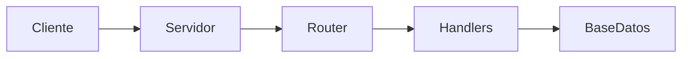

# Actividad 43. Documentación del proyecto

## Temas

- Documentación técnica
    
- Comunicación del software
    

## Ejercicio

Crear un README completo.

Debe incluir:

- Nombre del proyecto.
    
- Descripción.
    
- Objetivo.
    
- Requisitos.
    
- Instalación.
    
- Forma de ejecución.
    
- Estructura del proyecto.
    
- Capturas de pantalla.
    
- Ejemplos de uso.
    

Agregar documentación dentro del código.

Ejemplo:

```cpp
/**
 * Procesa las peticiones HTTP recibidas
 * y genera la respuesta correspondiente.
 */
void procesarPeticion();
```

---
# TEORÍA
---

## 1. ¿Por qué documentar?

- **Definición:** Documentar es registrar **qué hace** el software, **cómo se usa**, **cómo se instala** y **por qué** se tomaron ciertas decisiones.
- **Beneficio 1 — Onboarding:** Un nuevo desarrollador (o tú mismo dentro de 6 meses) entiende el proyecto en minutos, no en días.
- **Beneficio 2 — Mantenimiento:** Al volver a tocar el código, no tienes que releer todo para entender qué hace.
- **Beneficio 3 — Uso:** Otros pueden instalar, ejecutar y usar tu proyecto sin preguntarte.
- **Beneficio 4 — Profesionalismo:** Un proyecto sin documentación parece inacabado. Un README completo eleva la calidad percibida.
- **Beneficio 5 — Evaluación:** En contextos académicos o de portafolio, la documentación demuestra comprensión del proyecto.

**Regla de oro:** El código dice **cómo**; la documentación dice **qué**, **por qué** y **para qué**.

---

## 2. Tipos de documentación

### A. Documentación externa (para usuarios y desarrolladores)
- **README:** puerta de entrada. Todo proyecto debe tener uno.
- **Guía de instalación:** cómo preparar el entorno.
- **Guía de uso:** cómo interactuar con el sistema.
- **API docs:** endpoints, parámetros, respuestas.
- **CHANGELOG:** qué cambió en cada versión.
- **LICENSE:** términos de uso.
- **CONTRIBUTING:** cómo colaborar (si es open source).

### B. Documentación interna (para desarrolladores)
- **Comentarios en el código:** explican bloques complejos.
- **Docstrings / comentarios de función:** qué hace, qué recibe, qué devuelve.
- **Comentarios de clase:** responsabilidad y relaciones.
- **Diagramas:** arquitectura, flujo, entidades.
- **ADRs (Architecture Decision Records):** decisiones de diseño y su porqué.

**Prioridad para esta actividad:** README completo + comentarios dentro del código.

---

## 3. Estructura recomendada del README

Un README bien organizado suele seguir este orden:

1. **Título del proyecto.**
2. **Descripción breve** (1-3 frases).
3. **Objetivo** (qué problema resuelve, para qué sirve).
4. **Características principales** (funcionalidades).
5. **Capturas de pantalla** (opcional pero recomendado).
6. **Tecnologías usadas** (C++, HTML, CSS, JS, SQLite, etc.).
7. **Requisitos** (SO, compilador, librerías).
8. **Instalación** (pasos concretos).
9. **Ejecución** (comandos).
10. **Estructura del proyecto** (árbol de carpetas).
11. **Uso / Ejemplos** (cómo interactuar con el sistema).
12. **API** (endpoints disponibles).
13. **Formato de los datos** (archivos o tablas).
14. **Autor(es).**
15. **Licencia.**
16. **Agradecimientos / Referencias** (opcional).

No todos son obligatorios, pero cubrir los principales hace un README profesional.

---

## 4. Sección por sección

### A. Título
- Claro y descriptivo.
- Puede incluir un subtítulo con el tipo de proyecto.
- Opcional: un badge o logo (si el proyecto lo tiene).

### B. Descripción
- **Qué es** el proyecto en una o dos frases.
- **Qué hace** a grandes rasgos.
- **Para quién** está pensado (estudiantes, administradores, etc.).
- Evita jerga innecesaria.

### C. Objetivo
- **Qué problema resuelve.**
- **Por qué existe** el proyecto.
- **Qué se espera lograr** con él.
- Puede incluir los objetivos de aprendizaje si es académico.

### D. Características principales
- Lista de funcionalidades destacadas.
- Formato de viñetas.
- Órdenadas por importancia o por módulo.
- **Ejemplo conceptual:**
  - Gestión de usuarios con roles (alumno, maestro, admin).
  - Autenticación con sesiones y cookies.
  - Subida y descarga de archivos.
  - Panel administrativo con CRUD completo.

### E. Capturas de pantalla
- Muestran la interfaz real.
- Ubicación: carpeta `docs/` o `screenshots/` dentro del repo.
- En el README, se enlazan con rutas relativas.
- **Recomendación:** 2-4 capturas de las pantallas principales.
- **Ventaja:** Quien visita el repo entiende de un vistazo cómo se ve.

### F. Tecnologías usadas
- Lenguaje principal (C++17, por ejemplo).
- Frameworks (ninguno o los que uses).
- Librerías (SQLite, OpenSSL, etc.).
- Frontend (HTML5, CSS3, JavaScript ES2020).
- Sistema operativo soportado (Linux, Windows, macOS).
- **Formato:** lista o tabla.

### G. Requisitos
- **Software necesario:**
  - Compilador (`g++ 9+`, `clang++ 10+`, MSVC 2019+).
  - `make` o `cmake`.
  - Librerías del sistema (`libsqlite3-dev`, `libssl-dev`, etc.).
  - Navegador moderno.
- **Hardware mínimo:** si es relevante.
- **Sistema operativo:** Linux, macOS, Windows con MinGW/WSL.
- **Formato:** lista con versiones concretas cuando sea posible.

### H. Instalación
- Pasos concretos, numerados.
- Comandos que el usuario puede copiar y pegar.
- **Ejemplo conceptual:**
  1. Clonar el repositorio.
  2. Instalar dependencias.
  3. Compilar.
  4. (Opcional) Ejecutar tests.
- **Cuidado con rutas absolutas.** Usa rutas relativas.
- **Incluye ejemplos para cada sistema operativo** si difieren.

### I. Ejecución
- Comando exacto para arrancar el servidor.
- Puerto por defecto.
- URL a abrir en el navegador.
- Cómo detenerlo (Ctrl+C).
- **Ejemplo conceptual:**
  ```bash
  ./servidor
  # Abrir http://localhost:8080
  ```

- **Credenciales por defecto** (si las hay): usuario y contraseña iniciales.

### J. Estructura del proyecto
- Árbol de carpetas con explicación breve de cada una.
- **Ejemplo conceptual:**
  ```
  Proyecto/
  ├── src/        Código fuente del backend
  ├── include/    Cabeceras
  ├── public/     Archivos del frontend
  ├── data/       Datos persistentes
  └── README.md
  ```

- **Ventaja:** Quien lo lee entiende dónde está cada cosa.

### K. Uso / Ejemplos
- **Flujo típico de uso:**
  1. Abrir la página.
  2. Iniciar sesión.
  3. Registrar un alumno.
  4. Subir un archivo.
- **Ejemplos de peticiones a la API:**
  - Con `curl` o con capturas de Postman.
- **Capturas del panel administrativo** en acción.

### L. API (endpoints)
- Tabla con:
  - Método HTTP.
  - Ruta.
  - Propósito.
  - Rol requerido.
  - Parámetros (cuerpo o query).
  - Respuesta esperada.
- **Ventaja:** Un consumidor de la API sabe qué usar sin leer el código.

**Ejemplo conceptual de tabla:**
```
| Método | Ruta              | Rol    | Descripción                |
|--------|-------------------|--------|----------------------------|
| POST   | /api/login        | público| Inicia sesión              |
| GET    | /api/usuarios     | admin  | Lista usuarios             |
| POST   | /api/usuarios     | admin  | Crea usuario               |
| PUT    | /api/usuarios/{u} | admin  | Actualiza usuario          |
| DELETE | /api/usuarios/{u} | admin  | Elimina usuario            |
```

### M. Formato de los datos
- **Archivos TXT:** formato de cada archivo con ejemplo.
  ```
  nombre|edad|matricula
  Ana|20|A001
  ```
- **Base de datos:** esquema de la tabla.
- **Ventaja:** Cualquiera puede inspeccionar los datos a mano.

### N. Autor
- Nombre(s), contacto (opcional), institución (si es académico).

### O. Licencia
- MIT, GPL, Apache, o "Uso académico".
- Si no la defines, el proyecto no tiene licencia explícita.

### P. Agradecimientos
- Profesor, compañeros, librerías usadas, tutoriales.

---

## 5. Formato Markdown para el README

- **Archivo:** `README.md` en la raíz del proyecto.
- **Título:** `# Título del proyecto`.
- **Subtítulos:** `##`, `###`, `####` (no saltes niveles).
- **Listas:** `-` o `1.` (con espacio después).
- **Código:** bloques con triple backtick y lenguaje.
  ````markdown
  ```bash
  g++ -std=c++17 src/*.cpp -o servidor -lsqlite3
  ```
  ````
- **Tablas:** con `|` y `---` para separar cabecera.
- **Enlaces:** `[texto](url)`.
- **Imágenes:** ``.
- **Negrita:** `**texto**`.
- **Cursiva:** `*texto*`.
- **Código inline:** `` `codigo` ``.
- **Separadores:** `---` en línea propia.

**Buena práctica:** Vista previa del README en GitHub o en VSCode (`Ctrl+Shift+V`) para ver cómo queda.

---

## 6. Capturas de pantalla

- **Qué capturar:**
  - Pantalla de login.
  - Panel administrativo.
  - Tabla de usuarios.
  - Formulario de registro.
  - Listado de archivos.
- **Cómo nombrarlas:** descriptivas (`login.png`, `panel-admin.png`).
- **Dónde guardarlas:** `docs/screenshots/` o `screenshots/` dentro del repo.
- **Cómo enlazarlas:** ``.
- **Formato:** PNG preferible (mejor calidad que JPG para UI).
- **Tamaño:** optimizadas, no de 5 MB cada una.
- **Alternativa:** GIFs cortos para mostrar flujos (login → panel → CRUD).

---

## 7. Documentación dentro del código

### A. Comentarios de archivo
- Al inicio del archivo, un bloque describiendo su propósito.
- **Ejemplo conceptual:**
  ```cpp
  /**
   * Servidor.cpp
   * Implementa el bucle principal del servidor HTTP y el enrutamiento
   * de peticiones hacia los handlers correspondientes.
   */
  ```

### B. Comentarios de clase
- Justo antes de la declaración de la clase.
- Qué representa y qué responsabilidad tiene.
- **Ejemplo conceptual:**
  ```cpp
  /**
   * Servidor: orquesta la recepción de conexiones TCP, el parseo HTTP
   * y la delegación al Router. No conoce detalles de persistencia.
   */
  class Servidor { ... };
  ```

### C. Comentarios de función
- Formato recomendado: bloque justo antes de la función.
- Campos: descripción, parámetros (`@param`), retorno (`@return`), excepciones (`@throws`).
- **Ejemplo conceptual:**
  ```cpp
  /**
   * Procesa las peticiones HTTP recibidas y genera la respuesta correspondiente.
   * @param peticion Petición HTTP ya parseada.
   * @param cliente Socket del cliente conectado.
   * @return Respuesta HTTP lista para enviar.
   */
  RespuestaHTTP procesarPeticion(const PeticionHTTP& peticion, int cliente);
  ```

- **Ventaja:** Herramientas como Doxygen generan documentación HTML automáticamente.
- **Estilo Doxygen:** `/** ... */` con etiquetas `@param`, `@return`, `@brief`, `@throws`.
- **Estilo JavaDoc:** similar, también aceptado por Doxygen.

### D. Comentarios inline
- Explican el **por qué** de una decisión, no el **qué**.
- **Mal:** `// suma 1 a i` antes de `i++`.
- **Bien:** `// se usa 3.0 para forzar división decimal`.
- **Cuándo usar:**
  - Algoritmos no obvios.
  - Decisiones de diseño.
  - Workarounds por bugs externos.
  - Reglas de negocio.

### E. Qué NO comentar
- Código obvio.
- Código autoexplicativo.
- Código muerto (mejor eliminarlo).
- TODOs sin contexto (si los dejas, que sean específicos).

---

## 8. Herramientas para documentar código

### A. Doxygen
- Procesa comentarios especiales y genera documentación HTML/PDF.
- Requiere usar etiquetas (`@param`, `@return`, etc.).
- **Ventaja:** Documentación navegable y buscable.
- **Configuración:** archivo `Doxyfile` en la raíz.
- **Uso conceptual:** `doxygen Doxyfile` genera la documentación.

### B. Sphinx (con Breathe)
- Más común en proyectos Python, pero puede combinarse con Doxygen para C++.

### C. MkDocs
- Genera sitios de documentación a partir de archivos Markdown.
- Ideal si ya tienes un README extenso y quieres una web estática.

### D. GitHub Wiki / Pages
- Wiki integrado en el repositorio.
- Pages genera un sitio estático a partir de Markdown.

### E. Comentarios estándar
- Sin herramientas: los comentarios igual son útiles para quien lee el código.

**Recomendación para esta actividad:** README completo + comentarios Doxygen en las clases y funciones principales. No es obligatorio generar documentación HTML, pero mencionarlo como opción.

---

## 9. Documentación de la API

### A. Qué documentar por endpoint
- **Método HTTP** (GET, POST, PUT, DELETE).
- **Ruta** exacta.
- **Propósito** (una frase).
- **Autenticación** requerida (sesión, rol).
- **Parámetros** (path, query, body) con tipo y validaciones.
- **Ejemplo de petición** (curl o JSON).
- **Respuesta exitosa** (código y cuerpo).
- **Errores posibles** (códigos y mensajes).

### B. Formatos
- **Tabla en Markdown:** cómoda para README.
- **OpenAPI / Swagger:** estándar profesional. Genera UI interactiva.
- **Postman Collection:** exportable y compartible.
- **RapiDoc / Redoc:** visualizadores de OpenAPI.

**Para esta actividad:** una tabla en el README con todos los endpoints. Suficiente y claro.

### C. Ejemplo conceptual de documentación de endpoint
```
### POST /api/usuarios

Crea un nuevo usuario.

**Requiere:** sesión activa con rol `admin`.

**Body (JSON):**
{
  "nombre": "Ana López",
  "usuario": "ana_lopez",
  "contrasena": "secreta",
  "rol": "alumno"
}

**Respuesta 201:**
{ "ok": true, "id": 1 }

**Errores:**
- 400: datos inválidos
- 409: usuario duplicado
- 403: sin permisos
```

---

## 10. Documentación de la arquitectura

- **Diagrama de capas:** muestra la separación (red, HTTP, aplicación, dominio, persistencia).
- **Diagrama de clases:** muestra las clases principales y sus relaciones.
- **Diagrama de flujo:** muestra el recorrido de una petición desde el navegador hasta la respuesta.
- **Herramientas:**
  - **draw.io** → diagramas manuales.
  - **PlantUML** → diagramas desde texto.
  - **Mermaid** → diagramas dentro de Markdown, compatibles con GitHub.

**Fragmento suelto (Mermaid en Markdown):**
````markdown

````

- **Ventaja:** Se visualizan directamente en GitHub.

---

## 11. CHANGELOG

- **Definición:** Registro de cambios por versión.
- **Formato:** fecha, versión, categorías (Added, Changed, Fixed, Removed).
- **Uso:** Facilita saber qué cambió entre versiones.
- **Estándar:** [Keep a Changelog](https://keepachangelog.com/).
- **Ejemplo conceptual:**
  ```
  ## [1.0.0] - 2025-06-15
  ### Added
  - Login con sesiones
  - Panel administrativo
  ### Fixed
  - Bug en parseo de cookies
  ```

- **Para esta actividad:** Opcional, pero deja claro qué versión estás documentando.

---

## 12. Buenas prácticas de documentación

- **Escribe para el lector, no para ti.** Asume que no sabe nada del proyecto.
- **Sé conciso.** Frases cortas. Directo al grano.
- **Usa ejemplos concretos.** Un comando real vale más que una descripción.
- **Mantén el README actualizado.** Un README desactualizado es peor que no tenerlo.
- **Verifica los comandos.** Cópialos y pégalos como si fueras un usuario nuevo.
- **Usa capturas de pantalla** para las pantallas principales.
- **Documenta los errores comunes** y cómo resolverlos.
- **Sé consistente en el formato.** Mismo estilo en todo el README.
- **Usa lenguaje claro.** Evita jerga innecesaria.
- **Incluye una tabla de contenidos** si el README es largo.
- **Enlaza a recursos externos** (documentación de librerías, tutoriales).
- **No dupliques información.** Si algo está en el código, no lo repitas en el README.
- **Comenta el código durante el desarrollo,** no al final. Es más probable que lo hagas bien.
- **Revisa la documentación al refactorizar.** Si cambia la estructura, actualiza el README.
- **Documenta las decisiones.** Un ADR explica el "por qué" de una decisión de diseño.
- **Menciona las limitaciones.** Sé honesto sobre lo que el proyecto no hace (todavía).

---

## 13. Errores comunes

| Error | Solución |
|-------|----------|
| **README inexistente** | Todo proyecto necesita uno. Empieza con lo básico. |
| **README desactualizado** | Actualízalo cada vez que cambies la estructura o los comandos. |
| **Instrucciones incompletas** | Prueba los pasos como si fueras un usuario nuevo. |
| **Comandos que no funcionan** | Cópialos y pégalos. Ajusta si tu entorno difiere. |
| **Falta la sección de requisitos** | Indica compilador, librerías y versiones mínimas. |
| **No hay ejemplos de uso** | Añade al menos un flujo típico paso a paso. |
| **Comentarios que repiten el código** | Comenta el "por qué", no el "qué". |
| **Comentarios desactualizados** | Revísalos al cambiar el código. |
| **Comentarios con formato inconsistente** | Usa el mismo estilo (Doxygen, por ejemplo) en todo el proyecto. |
| **Documentación duplicada** | Un solo lugar para cada cosa. README para el usuario; comentarios para el desarrollador. |
| **Sin capturas de pantalla** | Añade 2-4 imágenes de las pantallas principales. |
| **Sin tabla de endpoints** | Documenta cada ruta de la API con su método, rol y respuesta. |
| **Sin diagrama de arquitectura** | Un diagrama simple ahorra muchas palabras. |
| **Sin sección de licencia** | Define una licencia (aunque sea "uso académico"). |
| **Documentar en un idioma y comentar en otro** | Elige un idioma para todo el proyecto (o documenta ambos). |
| **Bloques de código sin lenguaje** | Especifica el lenguaje para el resaltado correcto. |
| **README con paredes de texto** | Usa listas, tablas, bloques, encabezados. La estructura ayuda a leer. |

---

## 14. Plantilla de README (estructura)

Un esqueleto conceptual para tu README:

```
# Nombre del Proyecto

Breve descripción de una o dos frases.

## 📋 Tabla de contenidos
- [Descripción](#descripción)
- [Objetivo](#objetivo)
- [Características](#características)
- [Capturas](#capturas)
- [Tecnologías](#tecnologías)
- [Requisitos](#requisitos)
- [Instalación](#instalación)
- [Ejecución](#ejecución)
- [Estructura](#estructura)
- [Uso](#uso)
- [API](#api)
- [Formato de datos](#formato-de-datos)
- [Autor](#autor)
- [Licencia](#licencia)

## 📖 Descripción
...

## 🎯 Objetivo
...

## ✨ Características
- ...
- ...

## 📸 Capturas


## 🛠️ Tecnologías
- C++17
- HTML5 / CSS3 / JavaScript
- SQLite

## 📦 Requisitos
- g++ 9+
- libsqlite3-dev
- Navegador moderno

## 🚀 Instalación
1. Clona el repositorio.
2. Instala las dependencias.
3. Compila.

## ▶️ Ejecución
```bash
./servidor
```
Abrir http://localhost:8080

## 📁 Estructura
```
Proyecto/
├── src/
├── include/
├── public/
└── data/
```

## 💻 Uso
1. Abrir la página.
2. Iniciar sesión.
3. ...

## 🔌 API
| Método | Ruta | Rol | Descripción |
|--------|------|-----|-------------|
| ...    | ...  | ... | ...         |

## 🗄️ Formato de datos
...

## 👤 Autor
...

## 📄 Licencia
...
```

- **Emojis opcionales:** ayudan a escanear visualmente, pero no son obligatorios.
- **Personaliza** según tu proyecto.

---

## 15. Comentarios de código: ejemplo de estilo

**Estilo Doxygen para una función:**
```cpp
/**
 * @brief Procesa las peticiones HTTP recibidas y genera la respuesta correspondiente.
 *
 * Recibe la petición ya parseada y el socket del cliente, determina la ruta
 * y delega al handler adecuado. Si la ruta no existe, devuelve 404.
 *
 * @param peticion Petición HTTP parseada (método, ruta, cabeceras, cuerpo).
 * @param cliente Socket del cliente conectado.
 * @return RespuestaHTTP Lista para serializar y enviar.
 * @throws std::runtime_error Si ocurre un error interno irrecuperable.
 */
RespuestaHTTP procesarPeticion(const PeticionHTTP& peticion, int cliente);
```

**Estilo bloque simple para una clase:**
```cpp
/**
 * Servidor
 * Orquesta las conexiones TCP, el parseo HTTP y el enrutamiento.
 * No conoce detalles de persistencia ni de lógica de negocio.
 */
class Servidor { ... };
```

**Comentario inline útil:**
```cpp
// Se usa 3.0 (double) en lugar de 3 (int) para forzar división decimal.
double promedio = (a + b + c) / 3.0;
```

**Comentario inline inútil (evítalo):**
```cpp
i++; // incrementa i
```

---

## 16. Verificación de la documentación

Antes de dar por terminada la documentación, revisa:

1. **¿Un recién llegado puede instalar y ejecutar el proyecto solo con el README?** Si no, faltan pasos.
2. **¿Los comandos que documentaste funcionan tal cual?** Cópialos y pégalos.
3. **¿El README refleja la estructura actual del proyecto?** Si refactorizaste, actualiza.
4. **¿Cada clase y función importante tiene un comentario descriptivo?**
5. **¿Los comentarios explican el "por qué", no el "qué"?**
6. **¿Hay capturas de las pantallas principales?**
7. **¿Está la tabla de endpoints completa?**
8. **¿El formato es consistente en todo el README?**
9. **¿Se ve bien el README en GitHub (o en la vista previa de VSCode)?**
10. **¿Documentaste las limitaciones o features pendientes?**
11. **¿Hay una licencia o mención de uso?**
12. **¿El autor está identificado?**
13. **¿Los bloques de código tienen el lenguaje especificado?**

---
# PASO A PASO

---
# Actividad 43 — Documentación del proyecto

## Objetivo
Crear un `README.md` completo y añadir comentarios Doxygen en las clases y funciones principales.

## Regla
El código dice **cómo**; la documentación dice **qué**, **por qué** y **para qué**.

---

## Paso 1 — Estructura de la carpeta de docs

```
Proyecto/
├── README.md
├── docs/
│   ├── screenshots/
│   │   ├── login.png
│   │   ├── panel-admin.png
│   │   ├── tabla-usuarios.png
│   │   └── archivos.png
│   └── arquitectura.md
└── CHANGELOG.md
```

---

## Paso 2 — `README.md` base

```markdown
# Sistema Escolar

Sistema de gestión escolar con backend en C++ (sockets TCP y SQLite)
y frontend en HTML/CSS/JavaScript. Permite autenticación con roles,
panel administrativo y gestión de archivos.

## 📋 Tabla de contenidos

- [Descripción](#descripción)
- [Objetivo](#objetivo)
- [Características](#características)
- [Capturas](#capturas)
- [Tecnologías](#tecnologías)
- [Requisitos](#requisitos)
- [Instalación](#instalación)
- [Ejecución](#ejecución)
- [Estructura](#estructura)
- [API](#api)
- [Formato de datos](#formato-de-datos)
- [Autor](#autor)
- [Licencia](#licencia)

## 📖 Descripción

Aplicación web educativa que expone una API REST sobre HTTP
y sirve una interfaz para administrar usuarios y archivos.

## 🎯 Objetivo

Practicar los fundamentos de:

- Servidores HTTP con sockets TCP en C++.
- Programación orientada a objetos.
- Autenticación con sesiones y cookies.
- Autorización por roles.
- Frontend con HTML/CSS/JS vanilla.

## ✨ Características

- Login con usuario y contraseña.
- Sesiones con cookies `HttpOnly`.
- Tres roles: alumno, maestro, admin.
- Panel administrativo con CRUD completo de usuarios.
- Subida y descarga de archivos.
- Persistencia en SQLite.
- Interfaz responsive.

## 📸 Capturas

### Login


### Panel administrativo


### Gestión de archivos


## 🛠️ Tecnologías

- **Backend:** C++17, sockets POSIX/Winsock, SQLite 3.
- **Frontend:** HTML5, CSS3, JavaScript ES2020.
- **Persistencia:** SQLite (archivo `data/sistema.db`).
- **Control de versiones:** Git + GitHub.

## 📦 Requisitos

- Compilador con soporte C++17:
  - Linux: `g++ 9+` o `clang++ 10+`.
  - macOS: `clang++` de Xcode.
  - Windows: MinGW-w64 o MSVC 2019+.
- `make`.
- `libsqlite3-dev` (Linux) o equivalente.
- Navegador moderno.

## 🚀 Instalación

1. Clona el repositorio:

   ```bash
   git clone https://github.com/tu-usuario/sistema-escolar.git
   cd sistema-escolar
   ```

2. Instala dependencias (Linux):

   ```bash
   sudo apt install build-essential libsqlite3-dev
   ```

3. Compila:

   ```bash
   make
   ```

4. Crea las carpetas de datos:

   ```bash
   mkdir -p data data/uploads
   ```

## ▶️ Ejecución

```bash
./servidor
```

Abre <http://localhost:8080> en el navegador.

**Credenciales por defecto** (crear manualmente en la BD la primera vez):

- Usuario: `admin`
- Contraseña: `admin123`
- Rol: `admin`

Detener con `Ctrl+C`.

## 📁 Estructura

```
Proyecto/
├── src/                    Código fuente del backend
│   ├── main.cpp
│   ├── Servidor.cpp
│   ├── Router.cpp
│   ├── HTTP.cpp
│   ├── Usuario.cpp
│   ├── BaseDatosSQL.cpp
│   └── RepositorioArchivos.cpp
├── include/                Cabeceras
├── public/                 Frontend
│   ├── index.html
│   ├── login.html
│   ├── admin.html
│   ├── archivos.html
│   ├── css/
│   ├── js/
│   └── img/
├── data/                   Datos persistentes
│   ├── sistema.db
│   └── uploads/
├── docs/                   Documentación adicional
├── Makefile
└── README.md
```

## 💻 Uso

1. Abre <http://localhost:8080/>.
2. Haz clic en "Iniciar sesión".
3. Ingresa las credenciales.
4. Según tu rol:
   - **admin**: accede a `/admin.html` para gestionar usuarios.
   - **maestro/alumno**: accede a su panel correspondiente.

## 🔌 API

| Método | Ruta | Rol | Descripción |
|--------|------|-----|-------------|
| POST | `/api/login` | público | Inicia sesión |
| POST | `/api/logout` | cualquiera | Cierra sesión |
| GET | `/api/perfil` | cualquiera | Datos del usuario actual |
| GET | `/api/usuarios` | admin | Lista usuarios |
| POST | `/api/usuarios` | admin | Crea usuario |
| PUT | `/api/usuarios/{u}` | admin | Actualiza usuario |
| DELETE | `/api/usuarios/{u}` | admin | Elimina usuario |
| PUT | `/api/usuarios/{u}/rol` | admin | Cambia rol |
| GET | `/api/archivos` | cualquiera | Lista archivos |
| POST | `/api/subir` | admin, maestro | Sube archivo |
| GET | `/archivo/{id}` | cualquiera | Descarga archivo |

### Ejemplo: login

```bash
curl -i -c cookies.txt -X POST -H "Content-Type: application/json" \
  -d '{"usuario":"admin","contrasena":"admin123"}' \
  http://localhost:8080/api/login
```

**Respuesta 200:**
```json
{"ok":true,"nombre":"Admin","rol":"admin"}
```

**Respuesta 401:**
```json
{"ok":false,"error":"Credenciales inválidas"}
```

## 🗄️ Formato de datos

### Tabla `usuarios` (SQLite)

| Columna | Tipo | Notas |
|---------|------|-------|
| `usuario` | TEXT | PRIMARY KEY |
| `nombre` | TEXT | NOT NULL |
| `contrasena` | TEXT | NOT NULL (⚠️ deuda técnica: texto plano) |
| `rol` | TEXT | `alumno` / `maestro` / `admin` |

### Índice de archivos (`data/uploads/index.txt`)

```
id|nombreOriginal|nombreDisco|mime|tamano|fecha|usuario
```

## 👤 Autor

- Tu Nombre — [tu@correo.com](mailto:tu@correo.com)

## 📄 Licencia

Uso académico. Consulta el archivo `LICENSE` (o el profesorado).
```

---

## Paso 3 — Comentarios Doxygen en clases

`include/Servidor.h`:

```cpp
/**
 * @file Servidor.h
 * @brief Clase principal que orquesta el servidor HTTP.
 */

/**
 * @class Servidor
 * @brief Acepta conexiones TCP, parsea peticiones HTTP, verifica
 *        sesión y rol, y delega al handler correspondiente.
 *
 * No conoce detalles de persistencia (delegado a BaseDatosSQL)
 * ni de rutas (delegado a Router). Solo orquesta.
 */
class Servidor {
    // ...
};
```

`include/Usuario.h`:

```cpp
/**
 * @class Usuario
 * @brief Clase base abstracta de todos los usuarios del sistema.
 *
 * Contiene los atributos comunes (nombre, usuario, contraseña, rol).
 * Las clases derivadas (Alumno, Maestro, Administrador) implementan
 * obtenerMenu() con su propio menú específico.
 */
class Usuario { /* ... */ };
```

---

## Paso 4 — Comentarios de función

```cpp
/**
 * @brief Autentica a un usuario con sus credenciales.
 *
 * Busca el usuario en la base de datos y compara la contraseña.
 * Si las credenciales son válidas, crea una sesión y devuelve
 * una respuesta con la cookie de sesión.
 *
 * @param cuerpo Cuerpo de la petición con JSON {usuario, contrasena}.
 * @return Respuesta HTTP con 200 (éxito) o 401 (fallo).
 */
string Servidor::procesarLogin(const string& cuerpo);
```

```cpp
/**
 * @brief Valida un ID de sesión y devuelve la sesión asociada.
 *
 * Elimina la sesión del mapa si ha expirado.
 *
 * @param id ID de sesión (valor de la cookie sessionId).
 * @param[out] salida Sesión encontrada si es válida.
 * @return true si la sesión existe y no ha expirado; false en otro caso.
 */
bool Servidor::validarSesion(const string& id, Sesion& salida);
```

---

## Paso 5 — Comentarios inline (el "por qué")

```cpp
// Usar random_device en lugar de rand(): rand() es predecible.
// Los IDs de sesión deben ser impredecibles.
std::random_device rd;

// Se usa 3.0 (double) en lugar de 3 (int) para forzar división decimal.
double promedio = (a + b + c) / 3.0;

// SQLITE_TRANSIENT: SQLite copia el string al vuelo. Necesario
// porque el Usuario se destruye después de esta llamada.
sqlite3_bind_text(stmt, 1, u.getUsuario().c_str(), -1, SQLITE_TRANSIENT);
```

---

## Paso 6 — `CHANGELOG.md`

```markdown
# Changelog

Todos los cambios notables del proyecto se documentan aquí.
Formato basado en [Keep a Changelog](https://keepachangelog.com/).

## [1.0.0] - 2025-01-15

### Added
- Login con sesiones y cookies HttpOnly.
- Autorización por roles.
- Panel administrativo con CRUD de usuarios.
- Subida y descarga de archivos.
- Persistencia en SQLite.

### Changed
- Refactorización completa a clases y múltiples archivos.
- Migración de TXT a SQLite.

### Fixed
- Corrección en el parseo de cookies con espacios.
- División entera en cálculo de promedios.

## [0.5.0] - 2025-01-05

### Added
- Servidor de archivos estáticos.
- Primeros endpoints `/api/*`.
- Página de login.
```

---

## Paso 7 — Verificación

1. Abre `README.md` en GitHub (o vista previa de VSCode con `Ctrl+Shift+V`). Debe verse bien.
2. Verifica que todos los comandos del README funcionan.
3. Intenta instalar el proyecto siguiendo **solo** el README. Si te falta un paso, el README está incompleto.
4. Las capturas deben cargarse correctamente.
5. Los enlaces del índice deben funcionar.

---

## ✅ Checklist de la Actividad 43

- [ ] `README.md` incluye todas las secciones del modelo.
- [ ] Los comandos de instalación y ejecución funcionan tal cual.
- [ ] Hay al menos 2 capturas de pantalla en `docs/screenshots/`.
- [ ] La tabla de endpoints está completa.
- [ ] Se documenta el formato de los datos (tablas, archivos).
- [ ] Existe `CHANGELOG.md`.
- [ ] Las clases principales tienen comentarios Doxygen.
- [ ] Los comentarios inline explican el "por qué", no el "qué".

## 🧠 Mini-reto
Genera documentación HTML con Doxygen. Crea un `Doxyfile` con `doxygen -g`, ajusta `INPUT = src include` y `OUTPUT_DIRECTORY = docs/doxygen`, ejecuta `doxygen Doxyfile`.
