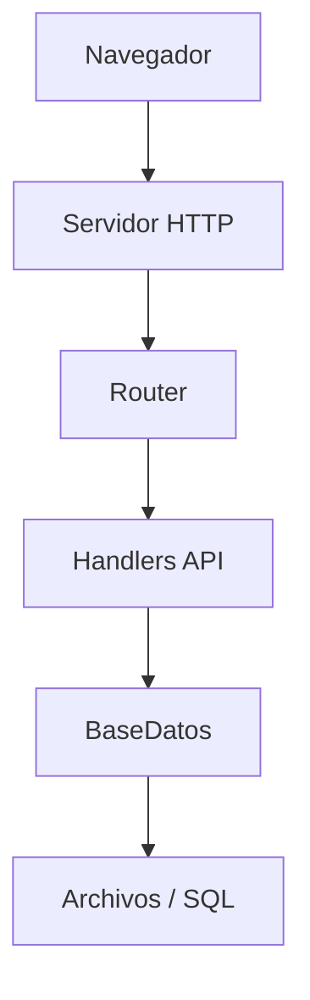

# Actividad 45. Presentación final

## Temas

- Presentación técnica
    
- Defensa del proyecto
    

## Ejercicio

Presentar la evolución completa del sistema.

La exposición debe mostrar:

### Inicio del proyecto

```text
main.cpp

Hola Mundo
```

↓

### Primer sistema

```text
Programa de consola

Clases básicas
```

↓

### Sistema web

```text
Servidor HTTP

HTML

CSS

JavaScript
```

↓

### Aplicación completa

```text
POO

API REST

Usuarios

Roles

Persistencia

GitHub
```

La presentación debe incluir:

- Demostración en vivo.
    
- Explicación de arquitectura.
    
- Explicación de clases principales.
    
- Problemas encontrados.
    
- Decisiones de diseño.
    
- Mejoras futuras.
    

---
# TEORÍA

---

## 1. ¿Qué es una presentación técnica?

- **Definición:** Exposición oral (con apoyo visual) en la que explicas un proyecto a una audiencia: profesor, compañeros, cliente, equipo técnico.
- **Objetivo:** Que la audiencia entienda **qué** hiciste, **cómo** lo hiciste, **por qué** tomaste ciertas decisiones y **qué aprendiste**.
- **Diferencia con una clase:** No enseñas teoría. Muestras **tu** trabajo, **tus** decisiones, **tus** resultados.
- **Duración típica:** 10-20 minutos + preguntas.
- **Regla de oro:** Menos es más. Es mejor cubrir pocos puntos con claridad que muchos a medias.

---

## 2. Estructura narrativa: contar una historia

La mejor presentación técnica tiene **arco narrativo**. No es un listado de features; es una **evolución**.

### A. Arco clásico de tres actos
1. **Planteamiento:** ¿De dónde venimos? El punto de partida (`main.cpp` con "Hola Mundo").
2. **Desarrollo:** ¿Qué hicimos? La evolución por etapas (consola → web → POO → sistema completo).
3. **Desenlace:** ¿A dónde llegamos? El sistema completo y qué hemos aprendido.

### B. Por qué funciona
- La audiencia sigue la historia con interés.
- Muestra que hubo un **proceso**, no solo un resultado.
- Refuerza el aprendizaje: cada etapa añadió algo.
- Facilita explicar decisiones: "en este punto necesitábamos X, por eso hicimos Y".

### C. Etapas sugeridas para tu proyecto
1. **Hola Mundo** → primeros pasos con C++.
2. **Programa de consola** → variables, condicionales, bucles, funciones.
3. **POO en consola** → clases, herencia, polimorfismo, archivos.
4. **Servidor web** → sockets, HTTP, servir archivos.
5. **API REST** → endpoints, JSON, fetch.
6. **Sistema completo** → autenticación, roles, persistencia, panel administrativo, GitHub.

- **Cada etapa** = una diapositiva (o dos).
- **En cada una:** qué se añadió, por qué, qué problema resolvió.

---

## 3. Estructura recomendada de la presentación

Un orden probado para una defensa técnica:

1. **Portada:** nombre del proyecto, autor(es), fecha.
2. **Introducción:** qué es el proyecto en una frase.
3. **Objetivo:** qué problema resuelve.
4. **Evolución:** las etapas del proyecto (el arco narrativo).
5. **Arquitectura:** visión general del sistema final.
6. **Clases principales:** las más importantes y su responsabilidad.
7. **Demostración en vivo:** la parte estrella.
8. **Problemas encontrados:** qué se rompió y cómo se resolvió.
9. **Decisiones de diseño:** por qué se eligió X y no Y.
10. **Mejoras futuras:** qué se podría añadir.
11. **Conclusiones:** qué se aprendió.
12. **Preguntas:** agradecer y abrir turno.

- **Duración:** cada bloque de 1-2 minutos.
- **Total:** 12-18 minutos.

---

## 4. Portada e introducción

### A. Portada
- Título del proyecto.
- Subtítulo descriptivo ("Sistema escolar con C++ y JavaScript").
- Nombre(s) del autor(es).
- Institución y fecha.
- Logotipo si aplica.

### B. Introducción (30 segundos)
- **Qué es:** una frase que resuma el proyecto.
- **Para quién:** quién lo usaría.
- **Por qué:** qué problema resuelve.
- **Ejemplo conceptual:** "Es un sistema escolar que permite gestionar alumnos, maestros y administradores desde una interfaz web, con backend en C++ y persistencia en archivos."

### C. Frase gancho
- Una frase inicial que capture la atención.
- **Ejemplo conceptual:** "Hace 45 actividades empezamos con un 'Hola Mundo'. Hoy tenemos un sistema con autenticación, roles y panel administrativo."

---

## 5. Evolución del proyecto

### A. Cómo mostrarla
- **Línea de tiempo visual:** una imagen o diagrama que muestre las etapas.
- **Diapositivas por etapa:** cada una con:
  - Título de la etapa.
  - Qué se añadió (una línea).
  - Una captura de pantalla o fragmento de código.
  - Qué problema resolvió.

### B. Qué destacar en cada etapa
- **Hola Mundo:** el punto de partida. Configuración del entorno.
- **Programa de consola:** primeros algoritmos, control de flujo.
- **POO en consola:** abstracción, reutilización, encapsulamiento.
- **Servidor web:** salto al mundo HTTP. Sockets y archivos estáticos.
- **API REST:** comunicación frontend-backend. JSON y fetch.
- **Sistema completo:** autenticación, autorización, CRUD, panel, GitHub.

### C. Reflexión por etapa
- En cada transición, pregunta: **¿qué problema nos obligó a avanzar?**
  - "Al crecer el código, necesitábamos organizarlo → POO".
  - "Al querer mostrar datos al usuario, necesitábamos un servidor → HTTP".
  - "Al querer comunicar frontend y backend, necesitábamos JSON → API REST".
- **Esto muestra pensamiento crítico**, no solo ejecución.

---

## 6. Explicación de arquitectura

### A. Qué mostrar
- Un **diagrama de capas** del sistema completo.
- Un **diagrama de clases** con las principales y sus relaciones.
- Un **diagrama de flujo** de una petición típica.

### B. Cómo explicarla
- **De arriba hacia abajo:** navegador → servidor → aplicación → persistencia.
- **De lo general a lo específico:** primero la visión general, luego el detalle de cada capa.
- **Con analogías:** "El servidor es la recepción de un edificio. Recibe peticiones y las deriva al departamento correcto."

### C. Capas a mencionar
1. **Frontend:** HTML, CSS, JavaScript. Lo que ve el usuario.
2. **Servidor HTTP:** recibe peticiones, parsea, responde.
3. **Router:** decide qué handler corresponde.
4. **Handlers / Aplicación:** lógica de cada endpoint.
5. **Dominio:** clases de datos (`Usuario`, `Alumno`, etc.).
6. **Persistencia:** lectura/escritura en disco o BD.

### D. Fragmento suelto (diagrama conceptual en Mermaid)


- **Ventaja:** Muestra en un vistazo cómo viaja una petición.

---

## 7. Explicación de clases principales

### A. Qué cubrir por clase
- **Nombre y responsabilidad:** "Servidor: acepta conexiones, parsea HTTP, enruta".
- **Atributos clave:** sin entrar en detalle, menciona los más importantes.
- **Métodos importantes:** los que definen su comportamiento.
- **Relaciones con otras clases:** "Servidor tiene una BaseDatosSQL", "Alumno es un Usuario".

### B. Clases típicas a explicar
- **`Servidor`:** orquesta el flujo HTTP.
- **`Router`:** decide qué handler ejecutar.
- **`HTTP`:** parseo y construcción de mensajes.
- **`Usuario`** (y derivadas): modelo de datos.
- **`BaseDatos`:** persistencia.

### C. Cómo explicarlas
- Una diapositiva por clase o grupo de clases.
- Un diagrama UML simplificado.
- Un ejemplo del mundo real: "Un Usuario es como un empleado. Un Alumno es un tipo específico de empleado con matrícula."

### D. Destaca la POO aplicada
- **Encapsulación:** los atributos son privados, se accede por métodos.
- **Herencia:** `Alumno`, `Maestro`, `Administrador` derivan de `Usuario`.
- **Polimorfismo:** un `Usuario*` puede apuntar a cualquiera de las tres clases.
- **Composición:** `Servidor` tiene una `BaseDatos`.

---

## 8. Demostración en vivo

### A. Preparación
- **Practica la demo varias veces antes del día.**
- **Ten un plan B:** capturas de pantalla o video pregrabado por si algo falla.
- **Entorno limpio:** servidor arrancado, navegador con pestañas preparadas, editor abierto.
- **Datos de prueba:** usuarios y archivos ya registrados para no improvisar.

### B. Guion de la demo (5-7 minutos)
1. **Abrir la página de inicio.** Mostrar el diseño.
2. **Login como admin.** Destacar el manejo de sesión.
3. **Panel administrativo:**
   - Mostrar la lista de usuarios.
   - Registrar un usuario nuevo.
   - Editar un usuario existente.
   - Cambiar el rol de un usuario.
   - Eliminar un usuario.
   - Buscar un usuario.
4. **Subida de archivos:**
   - Subir un documento.
   - Verlo listado.
   - Descargarlo.
5. **Logout.** Mostrar que la sesión se cierra.
6. **Login como alumno.** Mostrar que no puede acceder al panel de admin.

### C. Qué destacar durante la demo
- **Autenticación:** "El servidor emite una cookie con el ID de sesión; las siguientes peticiones la envían automáticamente."
- **Autorización:** "Si intento acceder a una ruta de admin como alumno, el servidor responde 403."
- **Persistencia:** "Reinicio el servidor y los datos siguen ahí."
- **Manejo de errores:** "Si intento registrar un usuario duplicado, el servidor lo rechaza con un mensaje claro."

### D. Qué NO hacer
- **No improvises.** Si no lo practicaste, no lo hagas.
- **No te disculpes** por cosas menores ("esto normalmente va más rápido").
- **No hagas la demo al final.** Hazla cuando la energía esté alta (a mitad de la presentación).
- **No leas el código** en pantalla. Muestra el comportamiento.
- **No te distraigas** con detalles técnicos irrelevantes.

### E. Plan B
- **Video pregrabado:** muestra la funcionalidad si el entorno falla.
- **Capturas de pantalla:** menos impactante, pero funciona.
- **Código comentado:** si algo no corre, puedes mostrar el fragmento clave.

---

## 9. Problemas encontrados

### A. Por qué contarlos
- **Muestra honestidad.** Nadie espera que todo salga perfecto a la primera.
- **Muestra aprendizaje.** Cada problema es una lección.
- **Muestra madurez técnica.** Encontrar y resolver problemas es parte del trabajo.

### B. Qué contar
- **2-3 problemas concretos.** No una lista interminable.
- **De cada uno:**
  - **Contexto:** en qué momento surgió.
  - **Síntoma:** qué fallaba.
  - **Causa:** por qué fallaba.
  - **Solución:** cómo lo resolviste.
  - **Aprendizaje:** qué te llevaste.

### C. Ejemplos típicos
- **Parseo HTTP incompleto:** el cuerpo llegaba cortado porque no se leía hasta completar `Content-Length`.
- **División entera en promedio:** el resultado salía sin decimales porque ambos operandos eran `int`.
- **Sesión perdida tras reinicio:** las sesiones vivían en memoria y se borraban al reiniciar el servidor.
- **Conflicto de merge en Git:** dos ramas modificaron el mismo archivo; resuelto manualmente.
- **XSS al mostrar nombres de usuario:** el nombre con `<script>` se ejecutaba; corregido con `textContent`.

### D. Cómo contarlos
- Con naturalidad. No te disculpes.
- Con el foco en la solución, no en el problema.
- Destacando qué aprendiste.

---

## 10. Decisiones de diseño

### A. Por qué explicarlas
- Muestran que **pensaste** las elecciones, no las copiaste.
- Muestran comprensión de **trade-offs**.
- Justifican por qué el proyecto es como es.

### B. Qué decisiones destacar
- **Lenguaje:** ¿por qué C++? ¿por qué JavaScript?
- **Arquitectura:** ¿por qué separar en capas?
- **Persistencia:** ¿TXT o SQL? ¿por qué?
- **Sesiones:** ¿cookies o tokens? ¿por qué?
- **API:** ¿REST o RPC? ¿por qué REST?
- **Frontend:** ¿vanilla JS o framework? ¿por qué vanilla?
- **Estructura de carpetas:** ¿por qué `src/`, `include/`, `public/`, `data/`?
- **Clases:** ¿por qué composición en lugar de herencia en X caso?

### C. Cómo presentarlas
- **Formato:** "Elegimos X en lugar de Y porque Z."
- **Ejemplo conceptual:** "Elegimos cookies con `HttpOnly` en lugar de guardar el token en `localStorage`, porque `HttpOnly` protege contra XSS."
- **Contrastar alternativas:** menciona qué otras opciones había y por qué las descartaste.

### D. Trade-offs típicos
- **Simple vs. escalable:** "TXT es simple pero no escala. SQL es más complejo pero soporta consultas y concurrencia."
- **Rápido vs. correcto:** "Podríamos haber hecho X rápido, pero preferimos hacerlo bien."
- **Flexible vs. rígido:** "Un enum de roles es más seguro, pero un string es más flexible."

---

## 11. Mejoras futuras

### A. Por qué mencionarlas
- Muestra **visión de futuro**.
- Muestra que conoces las **limitaciones actuales**.
- Demuestra que el proyecto **no está congelado**, sino en evolución.

### B. Qué mencionar
- **Técnicas:**
  - Migrar de TXT a SQLite/MySQL.
  - HTTPS con TLS.
  - Sesiones persistentes en BD.
  - 2FA (doble factor).
  - Rate limiting.
  - Paginación en la tabla de usuarios.
  - API en JSON Schema / OpenAPI.
- **Funcionales:**
  - Roles granulares con permisos.
  - Múltiples roles por usuario.
  - Módulo de calificaciones para maestros.
  - Reportes y estadísticas.
  - Notificaciones por correo.
  - Exportar datos a PDF/CSV.
- **De proceso:**
  - Tests automatizados.
  - Integración continua (GitHub Actions).
  - Contenedores (Docker).
  - Despliegue en la nube.

### C. Cómo presentarlas
- Agrupadas por categoría.
- Con prioridad: qué harías primero y por qué.
- Como lista corta (3-5 mejoras), no una lista interminable.

---

## 12. Conclusiones

### A. Qué incluir
- **Resumen en 3 puntos:**
  1. **Qué construiste:** "Un sistema escolar con frontend, backend, autenticación y roles."
  2. **Qué aprendiste:** "Aplicamos POO, arquitectura en capas, HTTP, Git y trabajo colaborativo."
  3. **Qué valor tiene:** "Es una base sólida para un sistema real, con margen de mejora claro."
- **Agradecimiento:** al profesor, al equipo, a quien corresponda.

### B. Frase de cierre
- Una frase que resuma el viaje.
- **Ejemplo conceptual:** "Empezamos con un `main.cpp` y un 'Hola Mundo'. Terminamos con un sistema completo y, más importante, con las bases para construir lo que venga."

---

## 13. Diapositivas: diseño y contenido

### A. Reglas de oro
- **Una idea por diapositiva.** No satures.
- **Poco texto.** Máximo 6-8 líneas.
- **Fuente grande.** Legible desde el fondo del aula.
- **Contraste alto.** Fondo claro con texto oscuro o viceversa.
- **Imágenes y diagramas** siempre que puedas.
- **Código solo si es esencial.** Fragmentos cortos (5-10 líneas).
- **Consistencia visual.** Misma paleta, misma tipografía.

### B. Qué evitar
- **Paredes de texto.** Nadie las lee.
- **Código completo.** Nadie lo sigue en una diapositiva.
- **Animaciones excesivas.** Distraen más que ayudan.
- **Fuentes decorativas.** Prioriza legibilidad.
- **Colores chillones.** Fondo blanco con texto negro es lo más legible.
- **Leer las diapositivas.** Si las lees, no las necesitas.

### C. Herramientas
- **PowerPoint, Keynote, Google Slides:** clásicas y suficientes.
- **Marp, Reveal.js:** diapositivas desde Markdown.
- **Canva:** plantillas prediseñadas.
- **Figma:** diseño más cuidado.

### D. Numeración y estructura
- Numera las diapositivas.
- Incluye una diapositiva de agenda al inicio.
- Incluye la misma agenda con el punto actual marcado en cada transición.

---

## 14. Habilidades de presentación oral

### A. Preparación
- **Ensaya en voz alta.** Varias veces.
- **Cronometra.** Ajusta si te pasas o te quedas corto.
- **Practica frente a alguien.** Pídele feedback.
- **Conoce el lugar.** Proyecta con tiempo si puedes.

### B. Durante la presentación
- **Habla despacio y claro.** La prisa es enemiga de la comprensión.
- **Contacto visual.** Con la audiencia, no con la pantalla.
- **Postura abierta.** No te escondas detrás del atril o el portátil.
- **Gestos naturales.** Sin exagerar.
- **Pausa después de cada punto.** Da tiempo a procesar.
- **Voz modulada.** Varía el tono para no aburrir.
- **No te disculpes.** Ni por los nervios, ni por el proyecto, ni por el tiempo.

### C. Manejo de la ansiedad
- **Respira profundo antes de empezar.**
- **Enfócate en el mensaje,** no en ti mismo.
- **Acepta los nervios.** Son normales y hasta útiles.
- **Ten el vaso de agua cerca.** Un sorbo da tiempo para pensar.
- **Practica hasta que te salga sin pensar.**

---

## 15. Preguntas de la audiencia

### A. Cómo manejarlas
- **Escucha completa.** No interrumpas.
- **Repite la pregunta** para que todos la oigan (si el aula es grande).
- **Responde con calma.** Piensa antes de hablar.
- **Si no sabes:** dilo. "No lo tengo medido, pero te puedo decir...". Mejor honesto que inventar.
- **Si la pregunta es compleja:** descompón en partes.
- **Si es hostil:** mantén la calma. Responde con hechos.
- **Agradece la pregunta.** Aunque sea crítica.

### B. Preguntas típicas y cómo prepararlas
- **¿Por qué elegiste C++?** → Rendimiento, aprendizaje de bajo nivel, requisito académico.
- **¿Por qué no usaste un framework?** → Didáctico, control total, entender el HTTP crudo.
- **¿Cómo manejas la concurrencia?** → Actualmente secuencial. Con hilos se necesitaría un mutex.
- **¿Cómo guardas las contraseñas?** → En texto plano como deuda técnica. En producción, hash con salt.
- **¿Qué pasa si el servidor se cae?** → Las sesiones en memoria se pierden. Los datos persisten.
- **¿Escala?** → Para un proyecto académico, sí. Para producción, migraría a SQL y añadiría hilos.
- **¿Cómo probaste?** → Pruebas manuales con curl, DevTools y navegador. Faltan tests automatizados.
- **¿Qué harías diferente?** → Respuesta honesta sobre alguna decisión.

### C. Preparación
- **Anticipa 5-10 preguntas** que podrían hacerte.
- **Escribe respuestas cortas.**
- **Ensáyalas en voz alta.**
- **Prepara ejemplos** para respaldar tus respuestas.

---

## 16. Uso del tiempo

### A. Distribución típica (15 minutos)
- **Introducción:** 1 minuto.
- **Evolución:** 3 minutos.
- **Arquitectura y clases:** 3 minutos.
- **Demo en vivo:** 5 minutos.
- **Problemas y decisiones:** 2 minutos.
- **Mejoras y conclusiones:** 1 minuto.
- **Preguntas:** 5-10 minutos adicionales.

### B. Reglas
- **Sé puntual.** Ni antes ni después.
- **Ten un cronómetro visible.** Ayuda a no desviarse.
- **Si te pasas:** corta lo menos importante (no la demo).
- **Si te quedas corto:** no rellenes con relleno. Cierra y abre preguntas.

### C. Ensayo con tiempo
- Al menos **3 ensayos cronometrados** antes del día.
- Ajusta el contenido según el tiempo real.

---

## 17. Trabajo en equipo (si aplica)

### A. Reparto de roles
- **Presentador principal:** abre, cierra, coordina.
- **Presentadores de sección:** cada uno presenta su área.
- **Operador técnico:** maneja la demo en vivo.
- **Moderador de preguntas:** toma nota y ordena las preguntas.

### B. Coordinación
- **Ensayen juntos.** No solo por separado.
- **Transiciones claras.** "Ahora mi compañero hablará de la arquitectura."
- **Consistencia visual.** Mismo diseño de diapositivas.
- **Sin solapamientos.** Cada uno tiene su parte.
- **Voz coherente.** Mismo tono y ritmo.

### C. Ventajas
- Menos carga por persona.
- Cubre más contenido.
- Muestra trabajo colaborativo (que es parte del proyecto).

---

## 18. Buenas prácticas

- **Ensaya varias veces.** No improvises.
- **Cronometra.** Respeta el tiempo asignado.
- **Ten plan B para la demo.** Video pregrabado o capturas.
- **Diapositivas limpias.** Poco texto, fuentes grandes.
- **Una idea por diapositiva.**
- **Muestra, no cuentes.** La demo vale más que mil palabras.
- **Cuenta una historia.** Evolución, no listado.
- **Sé honesto.** Sobre problemas, limitaciones, decisiones.
- **Reconoce al equipo.** Si trabajaron juntos, agradece.
- **Agradece al público.** Al final, siempre.
- **Prepara preguntas frecuentes.** Llega listo para el Q&A.
- **No leas las diapositivas.** Son apoyo, no guion.
- **Contacto visual.** Con la audiencia, no con la pantalla.
- **Habla despacio.** La claridad importa más que la velocidad.
- **No te disculpes.** Ni por nervios, ni por el proyecto.
- **Ten agua cerca.** Un sorbo da tiempo para pensar.
- **Llega temprano.** Prueba el equipo antes.
- **Conoce el lugar.** Dónde está la proyección, dónde te vas a mover.
- **Sonríe.** Transmite confianza.

---

## 19. Errores comunes

| Error | Solución |
|-------|----------|
| **No ensayar** | Ensaya al menos 3 veces, cronometrado. |
| **Leer las diapositivas** | Las diapositivas son apoyo. Mira a la audiencia. |
| **Diapositivas con demasiado texto** | Una idea por diapositiva, máximo 8 líneas. |
| **No tener plan B para la demo** | Video pregrabado o capturas. |
| **Pasar de tiempo** | Cronometra y ajusta. Corta lo menos importante. |
| **Hablar muy rápido** | Respira, pausa, modula. |
| **Disculparse por todo** | No te disculpes. Solo corrige y sigue. |
| **No mostrar la demo** | La demo es la estrella. Hazla sí o sí. |
| **Demo sin guion** | Ten un guion claro: qué hacer, en qué orden, qué destacar. |
| **No mencionar problemas** | Los problemas muestran aprendizaje. Cuéntalos. |
| **No justificar decisiones** | Explica el "por qué" detrás de cada elección. |
| **No hablar de mejoras futuras** | Muestra visión más allá del proyecto actual. |
| **No agradecer** | Agradece al final. Es de buena educación. |
| **No preparar preguntas** | Anticipa 5-10 y ensaya respuestas. |
| **Contestar sin pensar** | Pausa, piensa, responde. |
| **Inventar si no sabes** | Di "no lo tengo medido, pero...". Honestidad. |
| **Ignorar al equipo** | Si trabajaron juntos, reconoce a cada uno. |
| **Desorganización visual** | Consistencia: misma paleta, fuentes, estructura. |
| **Exceso de animaciones** | Menos es más. Solo las útiles. |
| **Diapositivas sin numerar** | Numera. Facilita el seguimiento. |
| **Código completo en diapositiva** | Fragmentos cortos (5-10 líneas). |
| **No practicar la demo** | Practícala como si fuera la primera vez. |
| **No probar el equipo** | Llega temprano y prueba proyector, sonido, internet. |

---

## 20. Checklist final

Antes del día de la presentación:

- [ ] Diapositivas terminadas y revisadas.
- [ ] Ensayo completo, cronometrado, al menos 3 veces.
- [ ] Demo practicada, con plan B preparado.
- [ ] Preguntas frecuentes anticipadas con respuestas.
- [ ] Entorno de demo limpio y preparado (servidor arrancado, navegador listo).
- [ ] Datos de prueba cargados (usuarios, archivos).
- [ ] Ropa cómoda y apropiada.
- [ ] Llegada temprana al lugar.
- [ ] Equipo probado (proyector, laptop, internet).
- [ ] Agua cerca.
- [ ] Respiración profunda antes de empezar.
- [ ] Cronómetro visible.

---

## 21. Resumen de conceptos clave

- **Presentación técnica:** comunicar el proyecto con claridad y honestidad.
- **Estructura narrativa:** inicio, desarrollo, desenlace. Contar una historia.
- **Bloques:** introducción, evolución, arquitectura, clases, demo, problemas, decisiones, mejoras, conclusiones.
- **Demo en vivo:** la estrella. Practicada, con guion y plan B.
- **Arquitectura:** explicar capas y clases con diagramas.
- **Problemas:** mostrarlos como aprendizaje, no como fracaso.
- **Decisiones de diseño:** justificar el "por qué" y los trade-offs.
- **Mejoras futuras:** mostrar visión más allá del proyecto.
- **Diapositivas:** poco texto, fuentes grandes, una idea por diapositiva.
- **Presentación oral:** hablar despacio, contacto visual, no leer, no disculparse.
- **Q&A:** escuchar, pensar, responder con honestidad.
- **Tiempo:** cronometrar, respetar, cortar lo menos importante.
- **Equipo:** coordinación y reparto de roles.
- **Buenas prácticas:** ensayar, plan B, consistencia visual, agradecimiento final.

---
# PASO A PASO

---
# Actividad 45 — Presentación final

## Objetivo
Presentar la evolución del proyecto: desde un `main.cpp` con "Hola Mundo" hasta un sistema completo con API REST, roles y persistencia.

## Duración típica
10-20 minutos + preguntas.

---

## Paso 1 — Estructura de la presentación

| Diapositiva | Tema | Tiempo |
|-------------|------|--------|
| 1 | Portada | 0:10 |
| 2 | Introducción (qué es, para quién) | 0:30 |
| 3 | Evolución: línea del tiempo | 1:00 |
| 4-5 | Hola Mundo → Consola → POO | 2:00 |
| 6-7 | Servidor web → API REST | 2:00 |
| 8 | Arquitectura final | 1:30 |
| 9-10 | Clases principales | 1:30 |
| 11-13 | **Demo en vivo** | 5:00 |
| 14 | Problemas encontrados | 1:30 |
| 15 | Decisiones de diseño | 1:30 |
| 16 | Mejoras futuras | 1:00 |
| 17 | Conclusiones | 0:30 |
| 18 | Preguntas | Q&A |

---

## Paso 2 — Portada

```markdown
# Sistema Escolar

## De un `main.cpp` a una aplicación web completa

**Tu Nombre**
Fecha
Institución
```

Diseño limpio, sin imágenes de relleno. Opcional: logo o captura de la pantalla principal de fondo.

---

## Paso 3 — Introducción (una frase)

> "Un sistema escolar que permite gestionar usuarios, roles y archivos desde el navegador. Backend en C++ con sockets TCP y SQLite. Frontend en HTML, CSS y JavaScript vanilla."

- **Qué es** en una frase.
- **Para quién**: administradores, maestros, alumnos.
- **Por qué**: aprender a construir un sistema web desde cero, sin frameworks.

---

## Paso 4 — Evolución (línea del tiempo)

```
Actividad 1-15   → Programas de consola, POO básica
Actividad 16-20  → HTML, CSS, JS (frontend)
Actividad 21-25  → Servidor HTTP con sockets
Actividad 26-31  → API REST con CRUD
Actividad 32-38  → Refactorización, POO, sesiones
Actividad 39-41  → Roles, panel admin, archivos
Actividad 42-44  → Refactorización final, docs, Git
Actividad 45     → Esta presentación
```

Diápositivas por etapa: qué se añadió, una captura, una frase de por qué.

---

## Paso 5 — Hola Mundo → Consola → POO

### Hola Mundo
- Punto de partida.
- Configuración del entorno.
- Primeros pasos con `std::cout`.

### Consola
- Variables, condicionales, bucles, funciones.
- Un programa que hace algo útil sin interfaz.

### POO
- Clases `Persona`, `Alumno`, `Maestro`, `Administrador`.
- Encapsulación, herencia, polimorfismo.
- Persistencia en TXT.

> "En este punto ya teníamos el 'modelo'. Aún sin usuario real, pero el dominio estaba modelado."

---

## Paso 6 — Servidor web → API REST

### Servidor HTTP
- Sockets TCP, `bind`, `listen`, `accept`.
- Parseo HTTP manual.
- Servir archivos estáticos desde `public/`.

### API REST
- Endpoints `/api/hola`, `/api/hora`, `/api/alumnos`.
- JSON como formato de intercambio.
- `fetch()` desde el frontend.

> "El salto de consola a web nos obligó a entender HTTP por dentro. No usamos ninguna librería: todo con sockets crudos."

---

## Paso 7 — Arquitectura final

Diagrama de capas:

```
Navegador (HTML/CSS/JS)
    │  HTTP
    ▼
Servidor (sockets + HTTP)
    │
    ▼
Router (autorización + enrutamiento)
    │
    ▼
Handlers (login, usuarios, archivos)
    │
    ▼
BaseDatosSQL ──► SQLite
RepositorioArchivos ──► data/uploads/
```

Frase clave: **"Cada capa tiene una responsabilidad única. Cambiar una no afecta a las demás."**

---

## Paso 8 — Clases principales

### `Servidor`
- Orquesta: acepta conexiones, parsea HTTP, delega.
- No sabe SQL ni archivos.
- Tiene `BaseDatosSQL` (composición).

### `Router`
- Decide qué handler ejecutar.
- Verifica autorización por rol.

### `Usuario` (+ derivadas)
- Clase base abstracta.
- `Alumno`, `Maestro`, `Administrador` implementan `obtenerMenu()`.

### `BaseDatosSQL`
- Persistencia.
- Encapsula SQLite.

> "Servidor **tiene una** BaseDatosSQL (composición). **No es una** BaseDatosSQL (no herencia). Esa fue una decisión consciente."

---

## Paso 9 — Demo en vivo (guion)

**Preparación previa:**
- Servidor arrancado.
- Base de datos con algunos usuarios de prueba.
- Navegador con pestañas: login, admin, archivos.
- Terminal abierta para mostrar logs.

**Guion (5 minutos):**

1. **Login como admin**
   - Abrir `/login.html`.
   - Ingresar credenciales.
   - Destacar: "El servidor emite una cookie con `HttpOnly`. Verifícalo en DevTools → Application → Cookies."

2. **Panel administrativo**
   - Registrar usuario nuevo.
   - Editar el usuario.
   - Cambiar el rol con el select.
   - Eliminar usuario con confirmación.
   - Buscar en tiempo real.

3. **Subir archivo**
   - Subir un PDF o imagen.
   - Verla listada.
   - Descargarla.
   - Abrir el archivo descargado y comparar con el original.

4. **Logout**
   - Cerrar sesión.
   - Ver que la cookie se borró.

5. **Login como alumno**
   - Intentar abrir `/admin.html`.
   - Destacar: "El frontend lo redirige, pero además el servidor responde 403 en cada API. Esa es la seguridad real."

6. **Persistencia**
   - Reiniciar el servidor.
   - Ver que los usuarios y archivos siguen.

**Plan B:** si algo falla, video pregrabado con la misma demo.

---

## Paso 10 — Problemas encontrados (2-3 ejemplos)

### Ejemplo 1: Parseo HTTP incompleto
- **Síntoma:** el cuerpo del POST llegaba cortado.
- **Causa:** un solo `recv` no garantiza leer todo.
- **Solución:** bucle leyendo hasta completar `Content-Length`.
- **Aprendizaje:** TCP es un stream, no un mensaje.

### Ejemplo 2: Promedio sin decimales
- **Síntoma:** `(8+9+10)/3` daba `9` en lugar de `9.00`.
- **Causa:** división entera en C++.
- **Solución:** usar `3.0` como divisor.
- **Aprendizaje:** el tipado importa.

### Ejemplo 3: Sesiones que se perdían
- **Síntoma:** al reiniciar el servidor, todos debían re-loguearse.
- **Causa:** sesiones en memoria.
- **Solución:** aceptado como limitación. Persistir en BD → trabajo futuro.
- **Aprendizaje:** toda decisión tiene trade-offs.

---

## Paso 11 — Decisiones de diseño

| Decisión | Alternativa | Por qué |
|----------|-------------|---------|
| Sockets crudos | Usar Crow / cpp-httplib | Aprendizaje: entender HTTP por dentro |
| SQLite | TXT / MySQL | Simple, sin servidor, suficiente |
| Cookies `HttpOnly` | `localStorage` con token | Protege contra XSS |
| JS vanilla | React / Vue | Aprendizaje: entender el DOM |
| Composición (Servidor tiene BD) | Herencia | Servidor **no es** una BD |
| Un solo rol por usuario | Multi-rol | Simplicidad; multi-rol es evolución |

Frase clave: **"Cada decisión tuvo un trade-off. No hay soluciones perfectas, solo las adecuadas para el contexto."**

---

## Paso 12 — Mejoras futuras

**Técnicas:**
- HTTPS con TLS (OpenSSL).
- Hash de contraseñas con bcrypt/argon2.
- Sesiones persistidas en BD.
- Rate limiting en login.
- 2FA.
- Tests automatizados (Catch2).
- CI con GitHub Actions.

**Funcionales:**
- Multi-rol por usuario.
- Permisos granulares (RBAC con permisos).
- Paginación y filtros avanzados en el panel.
- Reportes y estadísticas.
- Exportar datos a CSV/PDF.

**Proceso:**
- Docker para despliegue reproducible.
- Proxy inverso (nginx) delante del servidor C++.

Frase clave: **"El proyecto no está terminado. Está en un punto donde las mejoras son incrementales, no estructurales."**

---

## Paso 13 — Conclusiones

1. **Qué construimos:** un sistema escolar funcional con frontend, backend, autenticación, roles, archivos y persistencia.
2. **Qué aprendimos:** HTTP por dentro, POO aplicada, arquitectura por capas, control de versiones, documentación.
3. **Qué valor tiene:** base sólida para un sistema real, con un camino claro de mejoras.

Agradecer:
- Al profesorado.
- A los compañeros de equipo.
- A quien haya revisado PRs.

---

## Paso 14 — Preparar preguntas frecuentes

Anticipa estas y prepara respuestas cortas:

| Pregunta | Respuesta corta |
|----------|-----------------|
| ¿Por qué C++ y no Python/Node? | Requisito académico. C++ obliga a entender lo que pasa por debajo. |
| ¿Por qué no usaste un framework? | Didáctico. Quería entender HTTP crudo antes de usar abstracciones. |
| ¿Cómo manejas concurrencia? | Secuencial. Con hilos se necesitaría un mutex sobre `sesiones` y la BD. |
| ¿Contraseñas en texto plano? | Deuda técnica documentada. En producción: bcrypt + salt. |
| ¿Qué pasa si el servidor cae? | Sesiones se pierden. Datos persisten en SQLite. |
| ¿Escala? | Para un proyecto académico, sí. Para producción: hilos + Postgres. |
| ¿Cómo probaste? | `curl`, DevTools, navegador, casos borde. Faltan tests automatizados. |
| ¿Qué harías distinto? | Empezar con SQLite desde el principio, no migrar después. |
| ¿Cómo aseguras la autorización? | Middleware que verifica sesión + rol antes de cada handler. |
| ¿Por qué `textContent` y no `innerHTML`? | Previene XSS. Los datos del usuario nunca se interpretan como HTML. |

---

## Paso 15 — Reglas de las diapositivas

- **Una idea por diapositiva.**
- **Máximo 8 líneas de texto** (excepto código, y ese no más de 10 líneas).
- **Fuente grande:** 24pt mínimo.
- **Contraste alto:** fondo blanco, texto negro (o viceversa).
- **Sin animaciones decorativas.**
- **Imágenes de las pantallas reales**, no mockups.
- **Número de diapositiva** en cada una.

---

## Paso 16 — Durante la presentación

- **Habla despacio.** La claridad vale más que la velocidad.
- **Contacto visual** con la audiencia, no con la pantalla.
- **Pausa** después de cada punto importante.
- **No leas** las diapositivas.
- **No te disculpes** por los nervios ni por el proyecto.
- **Ten agua** cerca.
- **Cronómetro visible.**
- **Sonríe.** Transmite confianza.

---

## Paso 17 — Manejo del Q&A

- **Escucha completa** la pregunta antes de responder.
- **Repite la pregunta** si el aula es grande.
- **Piensa 2 segundos** antes de responder.
- **Si no sabes:** "No lo tengo medido, pero puedo decirte que...". Honestidad > inventar.
- **Si es hostil:** responde con hechos, no con emoción.
- **Agradece** la pregunta al final.

---

## Paso 18 — Checklist final

**Antes del día:**
- [ ] Diapositivas terminadas.
- [ ] Al menos 3 ensayos completos y cronometrados.
- [ ] Demo practicada y con plan B (video o capturas).
- [ ] Preguntas frecuentes anticipadas con respuestas.
- [ ] Ropa cómoda y apropiada.
- [ ] Dormir bien la noche anterior.

**El día:**
- [ ] Llegada temprana.
- [ ] Proyector, laptop e internet probados.
- [ ] Servidor arrancado y datos de prueba cargados.
- [ ] Navegador con pestañas preparadas.
- [ ] Terminal con logs visible.
- [ ] Cronómetro.
- [ ] Agua.
- [ ] Respiración profunda antes de empezar.

**Después:**
- [ ] Agradecer al público.
- [ ] Anotar las preguntas difíciles para mejorar.
- [ ] Celebrar. Lo lograste.

---

## ✅ Checklist de la Actividad 45

- [ ] Presentación con estructura narrativa (evolución, no listado).
- [ ] Diapositivas limpias con poco texto.
- [ ] Demo en vivo practicada y con plan B.
- [ ] Arquitectura y clases principales explicadas con diagramas.
- [ ] Al menos 2-3 problemas contados con su solución.
- [ ] Decisiones de diseño justificadas con trade-offs.
- [ ] Mejoras futuras mencionadas por categoría.
- [ ] Q&A anticipado con respuestas preparadas.
- [ ] Tiempo respetado (dentro del rango asignado).

## 🧠 Mini-reto
Graba un ensayo completo con tu teléfono. Míralo después. Vas a detectar 3 cosas que mejorar sin que nadie te las diga.